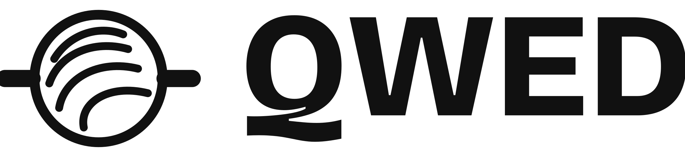

<picture>
  <source media="(prefers-color-scheme: dark)" srcset="qwed-lockup-white.png">
  
</picture>

### Runtime verification for AI output and agent actions

[Website](https://qwedai.tech) · [Docs](https://docs.qwedai.tech) · [Install](https://qwedai.tech/install) · [Limits](https://qwedai.tech/limits)

---

## What QWED does

QWED (Query With Evidence & Determinism) is open-source verification infrastructure for LLMs and AI agents. It checks the numbers, SQL, code and tool calls that AI produces, with solvers and parsers, before anything executes.

- A claim proven correct is admitted: `VERIFIED · ADMIT`.
- A claim proven wrong, one that cannot be proven, and one QWED cannot check are all denied by default.
- QWED decides; your integration, CI gate or agent runtime enforces the decision.
- Every decision leaves a record that a reviewer can check and re-run.

QWED verifies the formal statement, not what the AI meant, and it is only as sound as its engines. See [what QWED does not verify](https://qwedai.tech/limits), the [false-accept results published at every release](https://qwedai.tech/evidence) and the [security advisories](https://qwedai.tech/security).

**Engines.** Proof engines check maths with SymPy, logic with Z3, SQL with SQLGlot, code with Python AST rules and structured output with JSON Schema. Advisory engines record heuristic and model-based results, never as `VERIFIED`. [How the engine tiers work](https://qwedai.tech/engines).

---

## Repositories

**Core**

| Repository | What it does |
|---|---|
| [qwed-verification](https://github.com/QWED-AI/qwed-verification) | The verification engines, API, CLI and SDKs |
| [qwed-dashboard](https://github.com/QWED-AI/qwed-dashboard) | Dashboard for a QWED server: decision ledger, records, evidence and audit chain status (work in progress) |
| [docs](https://github.com/QWED-AI/docs) | Source of [docs.qwedai.tech](https://docs.qwedai.tech) |

**Domains**

| Repository | What it does |
|---|---|
| [qwed-finance](https://github.com/QWED-AI/qwed-finance) | Recomputes loans, interest, bonds, FX and risk figures exactly, and checks ISO 20022 and SWIFT messages |
| [qwed-legal](https://github.com/QWED-AI/qwed-legal) | Recomputes contract deadlines and liability caps, and finds contradictory clauses |
| [qwed-tax](https://github.com/QWED-AI/qwed-tax) | Checks AI-made tax decisions against encoded rules for the United States and India |
| [qwed-infra](https://github.com/QWED-AI/qwed-infra) | Proves what AWS IAM policies and network rules allow, and estimates cost before a Terraform change is deployed |

**Agents and protocols**

| Repository | What it does |
|---|---|
| [qwed-open-responses](https://github.com/QWED-AI/qwed-open-responses) | Checks agent tool calls and outputs before they run |
| [qwed-mcp](https://github.com/QWED-AI/qwed-mcp) | MCP server that lets Claude Desktop, VS Code and other MCP clients run Python calculations in a restricted subprocess |
| [qwed-a2a](https://github.com/QWED-AI/qwed-a2a) | Intercepts Agent-to-Agent messages, applies a trust boundary, checks money totals exactly and signs each decided result |
| [qwed-ucp](https://github.com/QWED-AI/qwed-ucp) | Checks the totals, state and structure of Universal Commerce Protocol checkouts before payment |

**CI and code review**

| Repository | What it does |
|---|---|
| [qwed-verification-action](https://github.com/QWED-AI/qwed-verification-action) | GitHub Action that scans for secrets, unsafe code and dangerous shell scripts, with SARIF output for code scanning |
| [QWED Security](https://qwedai.tech/platform/security) | GitHub App that checks every pull request with deterministic engines and signs its verdicts |

---

## Learning

[qwed-learning](https://github.com/QWED-AI/qwed-learning) is a free, open course on deterministic AI verification: fail-closed design, formal verification, audit integrity and trust boundaries.

---

## Research

| Paper | DOI |
|---|---|
| **QWED Protocol: Deterministic Verification for Large Language Models** (v1.1.0, January 2026) |  |
| **The Layered Compression Paradox in Context Engineering** |  |

The QWED Protocol paper's benchmark figures and its claims about other projects were withdrawn in October 2026; see the [errata](https://github.com/QWED-AI/qwed-verification/blob/main/docs/WHITEPAPER.md). Current results are on [qwedai.tech/evidence](https://qwedai.tech/evidence).

---

## Working with QWED

For deployments, integrations, custom guards or support, [contact us](https://qwedai.tech/contact) or write to [rahul@qwedai.tech](mailto:rahul@qwedai.tech).

---

## Get involved

- [Discussions](https://github.com/orgs/QWED-AI/discussions): questions and ideas
- [Issues](https://github.com/QWED-AI/qwed-verification/issues): bugs in the core
- [Security](https://github.com/QWED-AI/qwed-verification/security/advisories/new): report a vulnerability privately
- [Sponsor](https://github.com/sponsors/QWED-AI): support the work

---

